  <picture>
    <source media="(prefers-color-scheme: dark) and (prefers-reduced-motion: reduce)" srcset="assets/garden-dark-static.svg">
    <source media="(prefers-reduced-motion: reduce)" srcset="assets/garden-light-static.svg">
    <source media="(prefers-color-scheme: dark)" srcset="assets/garden-dark.svg">
    
  </picture>

### Aifa Maladina Ulya

Mathematics undergraduate at Universitas Negeri Yogyakarta. I test software and
I model systems. Both start by writing down what the thing is supposed to do,
then going to find out whether it does.

---

#### The garden

Every flower is a language in these repositories. The height is not decorative.
It tracks that language's share of bytes, read from the GitHub languages API,
so the garden rearranges itself as the repositories do.

| Flower | Language | Share | Where it grows |
|---|---|---|---|
| Red rose | Python | 41.4% | statistical modelling, clustering, machine learning coursework |
| Orange bougainvillea | HTML | 32.8% | a deployed mental-health companion app |
| Sunflower | Jupyter Notebook | 13.7% | exploratory analysis and model comparison |
| Pink sakura | TypeScript | 12.2% | the three Playwright test suites below |
| White daisy | CSS | under 0.1% | a seedling, and honestly reported as one |

The daisy is drawn at a floor size rather than to scale, because 23 bytes
rendered faithfully would be invisible. Every other flower is to scale, and the
figure under each one is the real number either way.

---

#### QA engineering

Three test suites, each against an application published for automation
practice, each with a findings report written the way a real defect report is.

| Repository | Tests | What it demonstrates |
|---|---|---|
| [restful-booker-api-tests](https://github.com/cyberstuck3/restful-booker-api-tests) | 30 passing | API testing, authorisation matrix, contract reconstruction |
| [saucedemo-e2e](https://github.com/cyberstuck3/saucedemo-e2e) | 38 passing | UI end-to-end, page objects, tiered cross-browser, defect characterisation |
| [web-auth-security-tests](https://github.com/cyberstuck3/web-auth-security-tests) | 34 passing | authentication and authorisation boundaries, header hygiene |

**102 tests.** The habits they are built to show:

- **Verify at the layer where the contract lives.** A UI assertion says a screen
  rendered. An API assertion says what the system agreed to.
- **Test authorisation as a matrix.** Three verbs crossed with three credential
  states is nine cells. Three separate "unauthorised" tests pass while leaving
  six unchecked.
- **Check that a refusal refused.** A 403 that still mutates the record is a real
  defect class, and a status-code assertion never sees it.
- **Assert what is there, report what should be.** Where a target accepts input
  it should refuse, the test records the actual behaviour and the gap goes in the
  report. A permanently red suite is a suite nobody reads.

---

#### Elsewhere

Mathematical modelling: SIR epidemic parameter estimation by maximum likelihood
and least squares, presented with an international team at Nara Women's
University; equilibrium and stability analysis of a three-population nonlinear
ODE system; K-Means clustering of educational attainment across 256 Indonesian
districts.

Google Student Ambassador 2026 · BIB-LPDP scholarship awardee ·
[LinkedIn](https://www.linkedin.com/in/aifa-maladina/)
